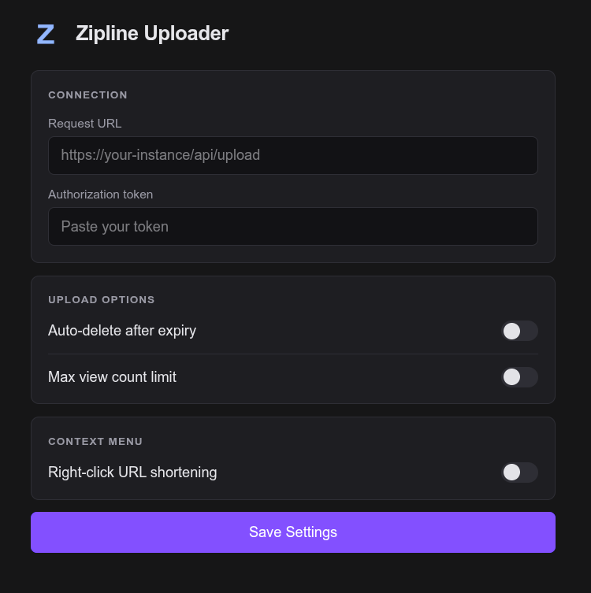

# Upload to Zipline

A browser extension that uploads media, screenshots, and clipboard images to your Zipline instance — from the right-click menu, keyboard shortcuts, or the toolbar Upload Hub — with optional URL shortening, auto-delete, view-count limits, and client-side image conversion.

[](https://addons.mozilla.org/en-US/firefox/addon/upload-to-zipline/)
[](https://chromewebstore.google.com/detail/upload-to-zipline/ngeeifojlejglmpkclhkopklbjkmlmdo)

<p align="center">
  
</p>

## Features

- Right-click any image, video, or audio → upload to your Zipline instance
- Area snip screenshot: drag to select part of the page and upload it (`Alt+Shift+S`)
- Visible tab screenshot in one click (`Alt+Shift+V`)
- Clipboard image upload — paste with `Ctrl+V` in the popup, or use `Alt+Shift+U`
- Toolbar Upload Hub with drag-and-drop, file picker, and your 5 most recent uploads
- Right-click any link → "Shorten URL with Zipline" (optional)
- Auto-delete uploads after a configurable expiry (1h to 1y)
- Per-upload max view-count limit
- Client-side image format conversion (WebP, AVIF, JPEG, PNG) with quality settings
- Automatic clipboard copy of returned URLs
- English, Traditional Chinese, and Japanese UI, following your browser language by default
- Cross-browser: Chrome and Firefox built from one codebase

## Configuration

1. Click the extension's toolbar icon to open the popup, then open the **Settings** tab (or right-click → Manage Extension → Options for the full-page version). The popup opens on Settings automatically until you're configured.
2. **Request URL** — your Zipline upload endpoint, e.g. `https://your-zipline-instance.com/api/upload`.
3. **Authorization Token** — your personal Zipline auth token.
4. Toggle and configure any of the **Upload Options**: auto-delete expiry, max-views limit.
5. Optionally enable **Image Processing** to convert images before upload, or Zipline's server-side compression under **Advanced**.
6. Under **Context Menu**, choose whether to show the **page screenshot & clipboard menus** and the **right-click URL shortening** item.
7. Click **Save Settings**.

The display language can be changed from the language picker in the popup or options header.

> The request URL and auth token can both be copied from your Zipline account's `.sxcu` ShareX export.

## Usage

### Upload Hub (toolbar popup)

- **Area Snip** — closes the popup and dims the page; drag to select a region, or press `Esc` to cancel.
- **Visible Area** — captures and uploads everything currently visible in the tab.
- **From Clipboard** — uploads the image you last copied. The first use asks for clipboard permission; pressing `Ctrl+V` anywhere in the popup works without it.
- **Drop zone** — click to pick a file or drag one in. Images, video, and audio are accepted.
- **Recent Uploads** — your last 5 uploads with copy and open buttons. Stored only on this device; **Clear History** removes them.

Keep the popup open until an upload from it finishes — closing it cancels the upload.

### Right-click menu

- On an image, video, or audio element: **Upload to Zipline**.
- On a link (if enabled): **Shorten URL with Zipline**.
- On the page background (if enabled): **Capture Area and Upload**, **Capture Visible Tab and Upload**, **Upload Image from Clipboard**.

### Keyboard shortcuts

| Shortcut | Action |
|---|---|
| `Alt+Shift+S` | Area snip and upload |
| `Alt+Shift+V` | Capture visible tab and upload |
| `Alt+Shift+U` | Upload clipboard image |

On Chrome, the clipboard shortcut and menu item open the popup, because the background service worker can't read the clipboard — click **From Clipboard** or press `Ctrl+V` there. On Firefox they upload directly.

Shortcuts can be changed at `chrome://extensions/shortcuts` (Chrome) or `about:addons` → ⚙ → **Manage Extension Shortcuts** (Firefox).

### Limitations

Screenshots aren't possible on browser-internal pages (`chrome://`, `about:`, etc.) or on the Chrome Web Store and Firefox Add-ons sites — browsers block extensions there.

## Development

### Prerequisites

- Node.js ≥ 20
- pnpm ≥ 8

### Install

```bash
pnpm install
```

### Develop

```bash
pnpm dev            # Chromium with HMR
pnpm dev:firefox    # Firefox with HMR
```

WXT auto-launches the browser with the extension loaded.

### Build

```bash
pnpm build          # → .output/chrome-mv3/
pnpm build:firefox  # → .output/firefox-mv3/
```

Load `.output/<browser>-mv3/` unpacked in your browser:
- **Chrome:** `chrome://extensions` → enable Developer mode → "Load unpacked" → select `.output/chrome-mv3/`.
- **Firefox:** `about:debugging#/runtime/this-firefox` → "Load Temporary Add-on" → select `.output/firefox-mv3/manifest.json`.

### Type check

```bash
pnpm compile
```

### Store-ready zips

```bash
pnpm zip          # → .output/upload-to-zipline-X.Y.Z-chrome.zip
pnpm zip:firefox  # → .output/upload-to-zipline-X.Y.Z-firefox.zip (+ -sources.zip for AMO)
```

## Architecture

Single source tree at the repo root, built for both browsers via [WXT](https://wxt.dev). Vue 3 + TypeScript for the popup and options surfaces, Tailwind v4 for styling. Background service worker (Chrome) / event page (Firefox) is a single `entrypoints/background.ts`; it handles the context menus, keyboard shortcuts, and screenshot capture. The area-snip overlay is a content script injected on demand only when a snip starts. Settings are stored in `browser.storage.sync` so they roam across signed-in browsers; upload history stays in `browser.storage.local`.

```
entrypoints/    # background, area-selector content script, popup, options
components/     # SettingsForm, QuickActions, DropZone, RecentUploads, LanguageSelect, ...
composables/    # useSettings (typed storage), useHistory (recent uploads), useI18n (translations)
utils/          # upload (shared Zipline upload + image conversion), url (protected-page checks)
types/          # Settings interface + presets
assets/         # Tailwind entry stylesheet
public/         # static icons
wxt.config.ts   # manifest, shortcuts, permissions + browser targets
```

## License

GNU General Public License v3.0 — see [LICENSE](LICENSE).
